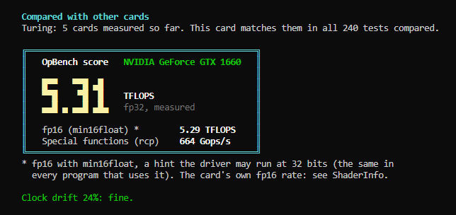
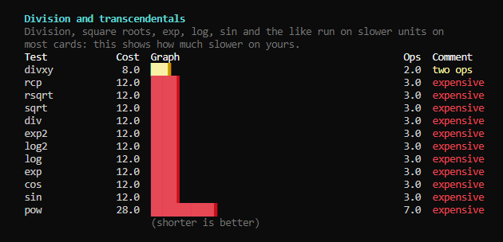
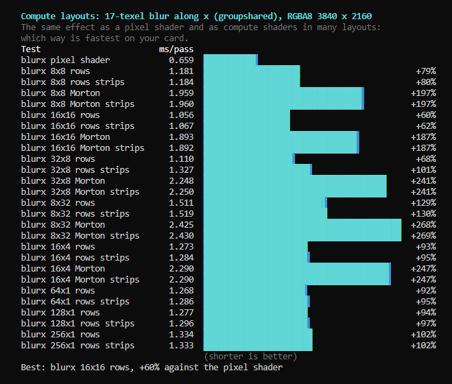

# SweetOpt: the super sweet shader optimizer

**SweetOpt makes shaders run faster, without changing what they compute.**

Shaders are the little programs a graphics card runs: for games, video players, emulators,
browsers, and ReShade effects like SweetFX. They do a lot of math for every pixel on your screen.
Often the same result can be computed with fewer steps. SweetOpt finds those shortcuts
automatically, double-checks that the result stays the same, and writes new copies of the
shaders that use them. Your original files are never changed.

SweetOpt reads:

- **ReShade effects** (`.fx`), with a simple menu for players (below).
- **HLSL** (`.hlsl`): pixel, vertex and compute shaders.
- **GLSL** (`.frag`, `.vert`, `.comp`, `.glsl`), including the Vulkan style.

See [Your own shaders](#your-own-shaders-hlsl-and-glsl) for HLSL and GLSL.

## What you get

- **Faster effects.** Less work for your graphics card means more frames per second, or room
  for more effects.
- **The same picture.** Every shortcut is tested on millions of values before it is used. If a
  change could make even a tiny visible difference, SweetOpt tells you, or leaves it out.
- **Safe to try.** SweetOpt writes its results to a separate folder. If you don't like them,
  delete the folder and nothing has changed.

## How to use it with ReShade (Windows)

1. Download `SweetOpt-<version>-windows-x64.zip` from the
   [Releases](https://github.com/CeeJayDK/sopt/releases) page and unzip it anywhere.
2. Double-click **SweetOpt.bat**. A simple menu opens.
3. Press **1** and pick your ReShade `Shaders` folder (the one inside `reshade-shaders`) to
   optimize every effect, or press **2** to pick one folder or one effect.
4. Press **5** to start. SweetOpt shows how far it has come and how long is left.
5. When it is done, press **7** to open the results. The `sopt-out` folder holds the faster
   copies of your effects, in the same folders as the originals.

Press **9** in the menu to open the full guide.

## Using the results

1. Make a backup of your game's `reshade-shaders\Shaders` folder.
2. Copy everything in `sopt-out` into your `Shaders` folder and choose **Replace**. Each file
   lands on the original it replaces. (The `sopt-...` text files are SweetOpt's report; you can
   leave them out.)
3. Start the game. That's it: the menu starts in **easy mode**, so the faster code is already in
   the files and there is nothing to set.

Don't add `sopt-out` to ReShade's effect search paths instead: ReShade would then load every
effect twice. To undo, put your backup back.

## The SOPT_ switches (expert mode)

Press **M** for **expert mode** if you want to choose between all the alternatives yourself
(or keep easy mode with a switch for each change). The files then keep the original code next to
each change, and ReShade lists these switches under the effect:

- **`SOPT_GROUP`** chooses for every change at once: **0** = the original code, **1** = the first
  alternative everywhere, **2** = the second, and so on. Expert mode starts at 0.
- **`SOPT_<file>_<line>`** chooses for one change only.

`SOPT_GROUP` is there for testing: step it through 0, 1, 2 ... and compare the picture and the
frame rate. If one number causes a problem, set `SOPT_GROUP` back to 0 and turn the single
switches on one by one to find the change behind it. Please tell us when that happens.

## Value ranges: more shortcuts

Some shortcuts are only correct for certain values (for example when a setting stays between 0
and 1). SweetOpt works out most ranges by itself. When the results say some shortcuts "need
value ranges", press **8**: a list opens with one line per value it could not work out, like

    # Vibrance.fx VibrancePass luma = [-1000, 1000]

If you know the real range, remove the `#` and correct the numbers (`... luma = [0, 1]`), save,
and press **5** again. Only give ranges you are sure of: a wrong range can change the picture.

## Your own shaders (HLSL and GLSL)

For shaders of your own project, run `sopt-fx` (in the SweetOpt zip) on a folder or on files:

    sopt-fx -o sopt-out my-project\shaders

The file type comes from the extension. `--entry NAME` names the entry point when it isn't
`main`, and `-I folder` adds a folder for `#include` files. SweetOpt writes the faster copies to
`sopt-out` with each change behind a `#if SOPT_...` switch, next to the original code, plus a
report of what it found. Texture reads and other things SweetOpt can't change are taken as they
are; it shortens the math around them. All options: [docs/technical.md](docs/technical.md).

## The other tools in this project

- **GPU Blueprint** (`GPU-Blueprint-<version>.zip`, double-click `GPU-Blueprint.bat`):
  measures what your graphics card and driver really do. If you send us the results, SweetOpt
  learns to make better choices for cards like yours. Thank you!

  
  
  

- **Test Host** (`Test-Host-<version>.zip`, double-click `Test-Host.bat`): runs ReShade on
  every graphics API (Direct3D 9 to 12, Vulkan, OpenGL) without a game, to test effects and
  take screenshots. See [tools/windows/README.md](tools/windows/README.md).

All of them are on the [Releases](https://github.com/CeeJayDK/sopt/releases) page and are built
automatically from the code in this repository.

## For developers

- How it works, all options and how to build it: [docs/technical.md](docs/technical.md)
- Which file does what (a map of the code): [docs/code-map.md](docs/code-map.md)
- Design and roadmap: [docs/design.md](docs/design.md) (Danish)

## Code signing policy

Free code signing provided by [SignPath.io](https://about.signpath.io/), certificate by
[SignPath Foundation](https://signpath.org/) (once the application is approved; until then the
release files are unsigned and listed with SHA256 checksums).

- Committers and reviewers: [CeeJayDK](https://github.com/CeeJayDK)
- Approvers: [CeeJayDK](https://github.com/CeeJayDK)

Only programs built from this repository's source by its release workflow are signed
(OpBench.exe, sopt-host.exe, sopt-fxc.exe, sopt-timer.addon64 / .addon32). ReShade64.dll in the
tools zip is built unchanged from crosire's ReShade 6.8.0 source and is not signed by this project.

## Privacy

None of the programs use the internet. They only write files next to themselves (GPU Blueprint
into its `Reports` folder, Test Host into its run folder, SweetOpt into its output folder).
GPU Blueprint's "Send the reports" option, and only if you choose it, opens a Dropbox upload
page in your browser, where you can upload the zip yourself. It contains your graphics card's
name, driver version and the measurements, nothing else.
